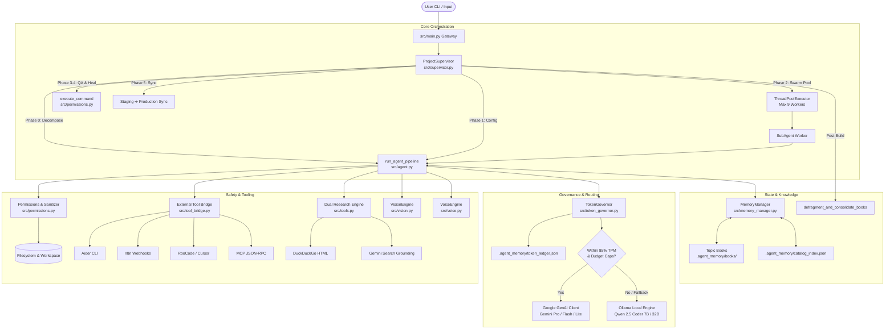
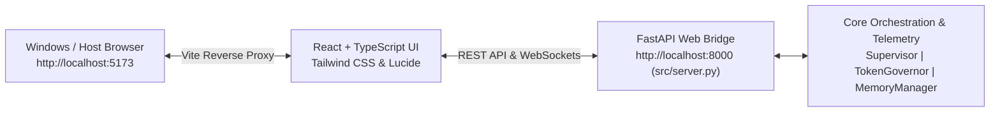

# Advance Assistant OS (v6.0)

> **Production-Grade Autonomous Multi-Agent Software Engineering Swarm & Operating System**

Advance Assistant OS is an architecture-aware, self-governing autonomous engineering operating system designed for complex, cross-platform software development across **Linux (WSL2)** and **Windows native filesystems**.

The system pairs Google Gemini cloud foundation models (Pro, Flash, and Lite tiers) with local Ollama open-weight models (`qwen2.5-coder:32b` for architectural planning and `qwen2.5-coder:7b` for high-speed code generation). It features autonomous task decomposition, multi-threaded sub-agent swarms with mutual-exclusion file locks, a strict sliding-window Token Governor with an 85% TPM Financial Shield, self-healing code loops, dynamic markdown topic book memory defragmentation, multimodal UI auditing, and external developer tool bridges (Aider, n8n, RooCode, Antigravity, MCP).

---

## Key Features & Capabilities

### 1. Supervisor-Worker Multi-Threaded Swarm
* **5-Phase Autonomous Build Pipeline**:
  * **Phase 0 (Decomposition & Blueprinting)**: High-tier reasoning engine decomposes high-level goals into isolated tasks mapped to specific target files, guided by historical project blueprint ledgers.
  * **Phase 1 (Config & Boilerplate Setup)**: Deterministically initializes project scaffolding (`package.json`, `requirements.txt`, directory trees) in Fast Tier.
  * **Phase 2 (Concurrent Workforce Swarm)**: Dispatches independent coding modules across a `ThreadPoolExecutor` (allocating up to 9 concurrent sub-agent threads).
  * **Phase 3 & 4 (Shell QA & Self-Healing)**: Executes automated verification tests (`pytest`, `npm test`, `python3 -m unittest`). When anomalies or tracebacks are detected, self-healing loops analyze the failure and generate targeted code repairs.
  * **Phase 5 (Staging Sync & Consolidation)**: Safely merges isolated staging sandboxes (`.staging_temp`) into production paths and triggers automatic memory defragmentation.
* **Workspace Staging Isolation**: Optional `.staging_temp` isolation guarantees zero direct writes to production roots until verification checks succeed.
* **Swarm Registry & Mutual Exclusion Locks**: Real-time domain locking prevents race conditions and concurrent sub-agent collisions on the same source files.
* **Live ANSI Terminal Monitor**: Thread-safe terminal dashboard rendering real-time worker task states, active operations, and sliding model quotas.

### 2. State & Knowledge Base Management
* **Categorized Topic Books**: Hierarchical Markdown knowledge store in `.agent_memory/books/` spanning 9 core engineering categories: `coding`, `frameworks`, `tools`, `cloud`, `tech_stack`, `environment`, `history`, `cs_fundamentals`, and `design_patterns`.
* **Dynamic Catalog Indexing**: `catalog_index.json` maintains real-time index metadata, file sizes, and paths for rapid context retrieval.
* **Autonomous Book Defragmentation**: Scans for micro-fragment notes (`domain_task_*.txt.md`, `temp_*.md`, files < 800 bytes), maps them to master topic books (e.g., `fastapi.md`, `react_typescript.md`, `sqlalchemy.md`), appends consolidated entries, and unlinks fragments.
* **Asynchronous Delta Learning Sync**: Background evaluator compares raw web research payloads against current offline memory books using `qwen2.5-coder:32b`. Only verifies and commits genuine technical parameter deltas.
* **Trace Synthesis**: Automatically parses code execution traces post-task and records newly discovered syntax patterns and bug fixes.

### 3. Token Governance & Financial Shield
* **Hardware Time Synchronization**: Synchronizes WSL2 clocks with hardware time (`sudo -n hwclock -s`) to eliminate virtual machine clock drift.
* **Quota Reset Anchor**: Automatically resets daily request counters at **1:30 PM IST** (matching the **Midnight Pacific Time (00:00 PT)** reset boundary for Google AI Studio).
* **Sliding-Window Concurrency Tracking**: Tracks rolling 60-second Request-Per-Minute (RPM) and Token-Per-Minute (TPM) windows.
* **Burst Pacing Guards**: Enforces micro-delay pacing between requests (1.5s for Pro models, 0.3s for Flash/Lite) to prevent multi-threaded burst throttling.
* **85% TPM Financial Shield**: Trips a circuit breaker when approaching 85% of tier token limits, gracefully cascading requests to Lite models or local Ollama instances without failing tasks or incurring billing.
* **Project-Level Pro Caps**: Enforces strict ceiling limits on heavy reasoning models (e.g., max 40 requests for `gemini-3.1-pro-preview`, max 200 for `gemini-2.5-pro` per project).
* **Model Constraining Profiles**: Filters allowed models dynamically (`HIGH_RPM_TPM`, `HIGHEST_RPM_TPM`, `PRO_PLAN`, `GEMINI_ONLY`, `GEMINI_3_ONLY`, `GEMINI_2_ONLY`, `OFFLINE_PURE`).

### 4. Local Model Inference & Dual-Tier Fallback
* **Local Orchestrator (`qwen2.5-coder:32b`)**: Handles complex architectural planning, schema matching, capability routing, and semantic delta evaluations.
* **Local Worker Bee (`qwen2.5-coder:7b`)**: Delivers fast, low-latency local code writes, boilerplate drafting, syntax verification, and targeted file repairs.
* **Pure Offline Mode**: Full capability to operate completely air-gapped without external cloud API access.

### 5. Cross-Platform Gatekeeper & Execution Security
* **Path Normalization**: Translates Windows drive notation (`D:\Project_Files` or `D:/Project_Files`) into WSL mount points (`/mnt/d/Project_Files`).
* **Filesystem Collision Resolver**: Resolves Linux `Errno 17 (File exists)` and `Errno 20 (Not a directory)` by removing lingering conflicting files in intermediate path segments.
* **Syntax & Output Sanitizer**: Strips markdown fences, trailing bold markers, conversational phrases, and validates `requirements.txt` specifiers.
* **Execution Whitelist**: Restricts shell execution to approved safe commands (`git`, `pytest`, `npm`, `python3`, `uvicorn`, etc.), prompting for human confirmation on unverified commands.

### 6. Multimodal Vision, Voice & External Tool Bridges
* **Vision Engine**: Playwright headless Chromium viewport capture (1280x800) coupled with Gemini 2.5 Flash multimodal inspection for UI layout, border margin, and CSS auditing.
* **Voice Engine**: CUDA-accelerated `faster-whisper` (float16) with lazy-loaded weights to conserve VRAM, paired with `espeak-ng` text-to-speech feedback.
* **Aider Batch CLI**: Dispatches batch non-interactive coding commands to Aider.
* **n8n Automation**: Triggers local Windows automation webhooks for enterprise integrations.
* **RooCode / Cursor Bridge**: Emits `.roocode_task.md` directives in target workspaces.
* **Model Context Protocol (MCP)**: JSON-RPC 2.0 communication bridge to external MCP tool daemons.

---

## System Architecture



---

## Repository Layout

```
advance_assistant/
├── .agent_memory/                  # Persistent brain & long-term memory store
│   ├── books/                      # Categorized Markdown Knowledge Books
│   │   ├── cloud/                  # Deployment, containerization, and cloud infra
│   │   ├── coding/                 # FastAPI, React, TypeScript, SQLAlchemy, async
│   │   ├── cs_fundamentals/        # OS, algorithms, networking, and databases
│   │   ├── design_patterns/        # Low-level and high-level design patterns
│   │   ├── environment/            # Environment configurations and platform notes
│   │   ├── frameworks/             # Deep framework implementation patterns
│   │   ├── history/                # Historical project execution logs
│   │   ├── tech_stack/             # System architecture notes
│   │   └── tools/                  # Developer tools and CLI automation notes
│   ├── ARCHITECTURE.md             # High-level architectural invariants
│   ├── catalog_index.json          # Indexed catalogue of all active topic books
│   ├── env_history.json            # History of recent project workspace paths
│   ├── execution_profiles.json     # Saved auto-detected strategy execution plans
│   ├── LEARNINGS.md                # Cross-session accumulated insights
│   ├── sub_agents.json             # 10-model sub-agent capability registry
│   ├── swarm_registry.json         # Active project locks and file mutexes
│   ├── TASKS.md                    # Active task queue and milestone tracking
│   └── token_ledger.json           # Persistent token counts, RPD, RPM, and TPM
├── .search_data/                   # Staging cache for raw web documentation scrapes
├── logs/                           # Multi-stream logging targets
│   ├── categories/                 # Categorical logs (models, tools, gatekeeper)
│   ├── daily/                      # Daily operational logs (YYYY-MM-DD.log)
│   ├── projects/                   # Project-isolated execution traces & blueprint ledgers
│   ├── master_timeline.log         # Global system-wide execution trace
│   └── latest_screenshot.png       # Viewport snapshot from VisionEngine
├── src/                            # Core engine source code
│   ├── agent.py                    # Intelligence router, model cascading, execution loop
│   ├── config.py                   # Model registry, rate limits, tier pools, profiles
│   ├── logger.py                   # Multi-stream thread-safe logger
│   ├── main.py                     # Master CLI gateway and command dispatcher
│   ├── memory_manager.py           # Knowledge base indexing, defrag, delta sync
│   ├── permissions.py              # Path normalizer, code sanitizer, gatekeeper
│   ├── supervisor.py               # Swarm orchestrator, thread pool, staging, monitor
│   ├── token_governor.py           # Rate limiting, financial shield, quota tracking
│   ├── tool_bridge.py              # Aider, n8n, RooCode, Antigravity, MCP bridges
│   ├── tools.py                    # DuckDuckGo scraper & Gemini Search Grounding
│   ├── vision.py                   # Playwright headless viewport capture & vision audit
│   └── voice.py                    # CUDA Faster-Whisper STT & espeak-ng TTS
├── test/                           # Test harness & benchmark suite
│   ├── test_data/                  # Isolated mock projects and temporary test workspaces
│   ├── test_logs/                  # Mirror execution logs per test script
│   └── test_scripts/               # Subsystem verification and stress benchmarks
│       ├── run_all_tests.py        # Master test suite runner
│       ├── test_defrag.py          # Memory book micro-fragment defragmentation test
│       ├── test_gemini_single.py   # Cloud Gemini call and cross-platform I/O test
│       ├── test_governor.py        # Token Governor sliding window & shield test
│       ├── test_incremental_stress.py # Multi-threaded stress sweeps across all models
│       ├── test_local_models.py    # Ollama hardware benchmark (TTFT and TPS metrics)
│       ├── test_offline_pipeline.py# Pure offline code generation & verification test
│       └── test_search_grounding.py# Scraper & Qwen 32B delta learning test
└── venv/                           # Python 3.10+ Virtual Environment
```

---

## Prerequisites & Setup

### 1. System Requirements
* **Operating System**: Linux (Ubuntu 22.04+ on WSL2) or native Linux.
* **NVIDIA GPU (CUDA)**: Recommended for CUDA float16 Faster-Whisper and GPU acceleration in Ollama.
* **System RAM**: Recommended 32GB+ system RAM to support offloading `qwen2.5-coder:32b`.
* **System Packages**:
  ```bash
  sudo apt-get update && sudo apt-get install -y \
      python3 python3-venv python3-pip \
      espeak-ng util-linux
  ```

### 2. Local Model Setup (Ollama)
Ensure [Ollama](https://ollama.com) is installed and running:
```bash
# Pull the dual-model system configurations
ollama pull qwen2.5-coder:32b    # Deep reasoning, blueprinting, delta deduplication
ollama pull qwen2.5-coder:7b      # High-speed code writer, syntax validation, repair
```

### 3. Environment & Virtualenv Setup
```bash
# Clone and enter the repository
cd /home/assistantuser/advance_assistant

# Create and activate virtual environment
python3 -m venv venv
source venv/bin/activate

# Upgrade pip and install core dependencies
pip install --upgrade pip
pip install google-genai ollama playwright faster-whisper beautifulsoup4 \
            requests httpx fastapi uvicorn pydantic pillow pytest torch

# Install Playwright browser binaries
playwright install chromium
```

---

## Environment Configuration

Create a `.env` file or export the following environment variables in your shell profile:

| Variable | Required | Default Value | Description |
| :--- | :---: | :--- | :--- |
| `GEMINI_API_KEY` | **Yes** (for Cloud) | `AIzaSy...` | Google AI Studio API key for Gemini 2.x/3.x models, search grounding, and vision. |
| `OLLAMA_HOST` | No | `http://127.0.0.1:11434` | Ollama daemon host address. |
| `N8N_WEBHOOK_URL` | No | `http://localhost:5678/webhook/advance-assistant-task` | Local n8n automation webhook endpoint. |
| `MCP_SERVER_URL` | No | `http://localhost:8080/mcp` | Base URL for active Model Context Protocol daemon. |

---

## Usage & Workflows

### Starting the Master CLI Gateway
Launch the interactive operational terminal:
```bash
source venv/bin/activate
python3 src/main.py
```

### Operational Commands & Directives

#### 1. All-in-One Swarm Build Command
Build full multi-file applications with automatic decomposition and concurrent workers:
```text
build: /mnt/d/Project_Files/MyApp | project: MyApp | mode: AUTO_DETECT | profile: MAX | constrain: HIGH_RPM_TPM | Create a full-stack FastAPI and React TypeScript dashboard with JWT auth and SQLite metrics.
```

#### 2. Isolated Staging Build Command
Execute the build inside `.staging_temp` and only merge upon test passage:
```text
build-isolated: /mnt/d/Project_Files/MyApp | project: MyApp | mode: HYBRID_CLOUD | profile: HIGH | Create a microservices health check router in backend/routes/health.py
```

#### 3. Dynamic Profile & Constraint Switching
```text
mode: AUTO_DETECT                # Options: AUTO_DETECT, OFFLINE_ONLY, HYBRID_CLOUD, OFFLINE_AGENTIC, HYBRID_AGENTIC
profile: MAX                     # Options: BASIC, MEDIUM, HIGH, MAX
constrain: HIGH_RPM_TPM          # Options: HIGH_RPM_TPM, HIGHEST_RPM_TPM, PRO_PLAN, GEMINI_ONLY, OFFLINE_PURE
```

#### 4. Maintenance & Utility Commands
```text
defrag                           # Consolidate micro-fragment notes into canonical master books
reindex                          # Rebuild .agent_memory/catalog_index.json
vision: http://localhost:3000    # Run Playwright viewport audit on running app
aider: /path | <task>            # Dispatch task to local Aider batch CLI
roocode: /path | <task>          # Generate .roocode_task.md for Cursor / RooCode
n8n: <task_description>          # Trigger Windows n8n workflow
test                             # Run system test harness
```

### Programmatic SDK Example
```python
from src.supervisor import ProjectSupervisor

# Initialize supervisor targeting a workspace
supervisor = ProjectSupervisor(
    target_destination="/mnt/d/Project_Files/Assistant_Projects/TaskVault",
    isolate=True,
    max_workers=8,
    project_name="TaskVault"
)

# Run complete development loop
supervisor.process_complete_development_cycle(
    master_instruction="Build a FastAPI backend with async SQLAlchemy and a Vite React frontend",
    mode_override="AUTO_DETECT",
    profile_level="MAX",
    constraining_profile="HIGH_RPM_TPM"
)
```

---

## Testing & Benchmarks

The project includes an end-to-end verification and stress testing harness in `test/test_scripts/`:

```bash
# Run the complete test suite
python3 test/test_scripts/run_all_tests.py
```

### Individual Subsystem Tests

#### 1. Token Governor & Financial Shield (`test_governor.py`)
Validates that normal token allocations on `gemini-3.5-flash` succeed and verifies that large token bursts (1.9M tokens) trigger the **85% TPM Financial Shield** block.
```bash
python3 test/test_scripts/test_governor.py
```

#### 2. Knowledge Book Defragmentation (`test_defrag.py`)
Creates a synthetic micro-fragment file (`domain_task_test99.txt.md`), runs `defragment_and_consolidate_books()`, and verifies the fragment is parsed, consolidated into `fastapi.md`, and unlinked.
```bash
python3 test/test_scripts/test_defrag.py
```

#### 3. Offline Pipeline & Local QA (`test_offline_pipeline.py`)
Verifies pure offline code generation using `qwen2.5-coder:7b` to write a verified FastAPI endpoint and validates the file syntax on disk.
```bash
python3 test/test_scripts/test_offline_pipeline.py
```

#### 4. Search Grounding & Qwen 32B Delta Pass (`test_search_grounding.py`)
Executes DuckDuckGo research scraping and tests the Qwen 32B delta evaluation pass with streamed tokens to prevent visual lockups.
```bash
python3 test/test_scripts/test_search_grounding.py
```

#### 5. Incremental Multi-Model Stress Sweeps (`test_incremental_stress.py`)
Executes multi-threaded concurrent stress sweeps across all 10 registered cloud models grouped by RPM ceilings:
* **Phase 1**: 4,000 RPM Lite pool (`gemini-3.5-flash-lite`, `gemini-3.1-flash-lite`, `gemini-2.5-flash-lite`).
* **Phase 2**: 1,000 RPM Flash pool (`gemini-3.6-flash`, `gemini-3.5-flash`, `gemini-2.5-flash`).
* **Phase 3**: Restricted Pro pool (`gemini-3.1-pro-preview`, `gemini-2.5-pro`).
```bash
python3 test/test_scripts/test_incremental_stress.py
```

#### 6. Local Ollama Hardware Benchmark (`test_local_models.py`)
Measures Time-to-First-Token (TTFT), generation latency, and Tokens-Per-Second (TPS) across both local models:
```bash
python3 test/test_scripts/test_local_models.py
```

---

## Web Dashboard Control Suite (v6.0)

Advance Assistant OS v6.0 introduces a modern, high-throughput web control center operating alongside the native CLI interface without altering or breaking existing core pipelines.



### 1. Web Dashboard Architecture
- **Frontend Stack**: React 18, TypeScript, Vite, Tailwind CSS, Lucide icons, React Router v6.
- **Backend Web Bridge**: FastAPI asynchronous server (`src/server.py`) exposing 8 non-blocking REST endpoints and a 1-second WebSocket telemetry stream (`/ws/telemetry`).
- **Network Routing**: Cross-Origin Resource Sharing (CORS) wildcard permissions enable zero-latency interoperability between Linux WSL2 and native Windows browsers.

### 2. Launch Instructions

#### For Linux / Ubuntu WSL2 (Unified Launcher)
Run the root shell launcher:
```bash
chmod +x ./start_dashboard.sh
./start_dashboard.sh
```
*Automatically activates the Python virtual environment, launches the FastAPI backend on port 8000, and spawns the Vite development server on port 5173.*

#### For Windows Host (1-Click Gateway)
Double-click `start_dashboard.bat` from Windows File Explorer.
*Verifies WSL availability, automatically opens your default Windows web browser to `http://localhost:5173`, and initializes background services.*

#### Native CLI Mode (100% Untouched)
The original command-line interface remains 100% functional and backward-compatible:
```bash
python3 src/main.py
```

### 3. The 8 Production Console Views

| Route | View Name | Primary Functionality |
| :--- | :--- | :--- |
| `/` | **Execution Studio** | Project workspace selector, blueprint presets, parameter matrix (Mode, Research, Constrain, Tier, Workers 1–16), staging isolation toggles, and collision-guarded background pipeline dispatching (`POST /api/execute`). |
| `/swarm` | **Live Swarm Monitor** | Real-time dual WebSocket/HTTP streaming, cooperative worker thread grid (up to 16 burst workers), domain file lock visualizer, multi-model sliding RPM/TPM/RPD gauges, and 85% TPM Financial Shield alerts. |
| `/agents` | **Agent & Model Hub** | Capability matrix across 85 verified models, best-in-class primary/fallback routing, dynamic Swarm Role Builder (`.agent_memory/swarm_profiles.json`), and the RTX 4060 8GB VRAM Arbitrator with one-click idle weight scavenging (`POST /api/bridge/vram/scavenge`). |
| `/knowledge` | **Knowledge Base Workspace** | Split-pane explorer across 9 canonical engineering categories, parsed discrete section inspector with code block detection, raw Markdown book editor with tags, operation recipe quick-adder (`POST /api/memory/book/recipe`), and the Precision Context Injection Simulator with model-aware token budgets and token savings telemetry. |
| `/governor` | **Token Governor** | Daily quota reset anchor (1:30 PM IST / 00:00 PT), comprehensive 11-model registry limits table with live usage snippets, 7 model constraining profiles, and Pro model hard project cap failover rules. |
| `/keys` | **Multi-API Key Matrix** | Dynamic key pool dispatcher (`.agent_memory/gemini_keys.json`), 4 routing policies (`GLOBAL_HYBRID`, `FREE_POOL`, `PAID_POOL`, `SINGLE_PINNED`), per-key usage telemetry, selection toggles, and live connectivity tester (`POST /api/keys/test`). |
| `/logs` | **Multi-Stream Log Center** | Dedicated full-screen console with 6-stream switcher (Master, Daily, Categories, Models, Projects, Benchmark Tests), severity and regex keyword filtering, auto-scroll freeze, and live sub-second WebSocket tail (`/ws/logs`). |
| `/tools` | **Tool Bridges & Adapters** | External adapter matrix (Aider CLI, n8n, RooCode, Antigravity Sandbox, Vision, Voice), dual-engine research scraper status (`BASIC`, `MEDIUM`, `HIGH`, `MAX`), and system environmental invariant monitors. |

### 4. Advanced v6.0 Production Subsystems

#### A. Multi-API Key Dispatcher & Policy Governor
- **Zero Downtime Rotation**: Operates a stateful multi-key pool (`.agent_memory/gemini_keys.json`) rotating between free and paid Gemini API keys with automatic failover upon HTTP 429 rate limit events.
- **Routing Policies**: Configurable on-the-fly via `/keys` or `POST /api/keys/policy`:
  - `GLOBAL_HYBRID`: Prioritizes free keys during warm-up; dynamically promotes to paid tier for complex architectural passes.
  - `FREE_POOL`: Strict quota confinement using zero billable tokens.
  - `PAID_POOL`: Maximizes parallelism and eliminates TPM bottlenecks during burst development cycles.
  - `SINGLE_PINNED`: Pins execution exclusively to an administrator-selected key ID.

#### B. Read-Only Testing Bridge & RTX 4060 8GB VRAM Arbitrator
- **Model Capability Matrix**: Connects read-only to `/mnt/d/Project_Files/Ollama_Models_Testing` to evaluate 85 local and cloud models across 8 engineering dimensions (`Coding`, `SQL`, `Tool Calling`, `Vision`, `Redteaming`, `Medical`, `Math`, `RAG`).
- **Hardware Arbitrator**: Dynamically monitors NVIDIA RTX 4060 8GB dedicated VRAM usage and installed Ollama weights.
- **Idle Scavenger**: Safely evicts dormant model weights from GPU memory (`POST /api/bridge/vram/scavenge`) without interrupting active swarm worker threads.

#### C. Precision Snippet Memory Engine & Offline Simulator
- **Discrete Section Parser**: Splits Markdown books into discrete `## ` and `### ` heading blocks with token estimations and code-block detection.
- **TF/Keyword Scorer**: Ranks sections using weighted heuristics (`Heading 3x`, `Category/Book 2.5x`, `Body 1x`, `Code +1.5x`).
- **Model-Aware Budgeting**: Injects context sized to model capacity (600 tokens for Small 1.5B, 1200 for 7B/14B, 2000 for 32B, 3500 for Gemini Pro), delivering up to 85%+ token savings.
- **Interactive Simulator**: Accessible via `/knowledge`, allowing engineers to preview exact injected prompt contexts and measure token savings before running swarm jobs.

### 5. Automated E2E System Certification Suite

Run the full automated certification harness across all 7 core subsystems:
```bash
./venv/bin/python3 test/test_scripts/test_v6_full_suite.py
```
*Validates 28 architectural checkpoints including Core Health & Config, Multi-Key Matrix & Routing, Testing Bridge & VRAM Arbitrator, Swarm Profiles & Concurrency Scaling, Multi-Stream Logs & Path Traversal Guards, Precision Memory Snippets & Book CRUD Roundtrip, and Dual WebSocket Streams.*

---

## License

Advance Assistant OS is open-source software licensed under the Apache 2.0 License.
