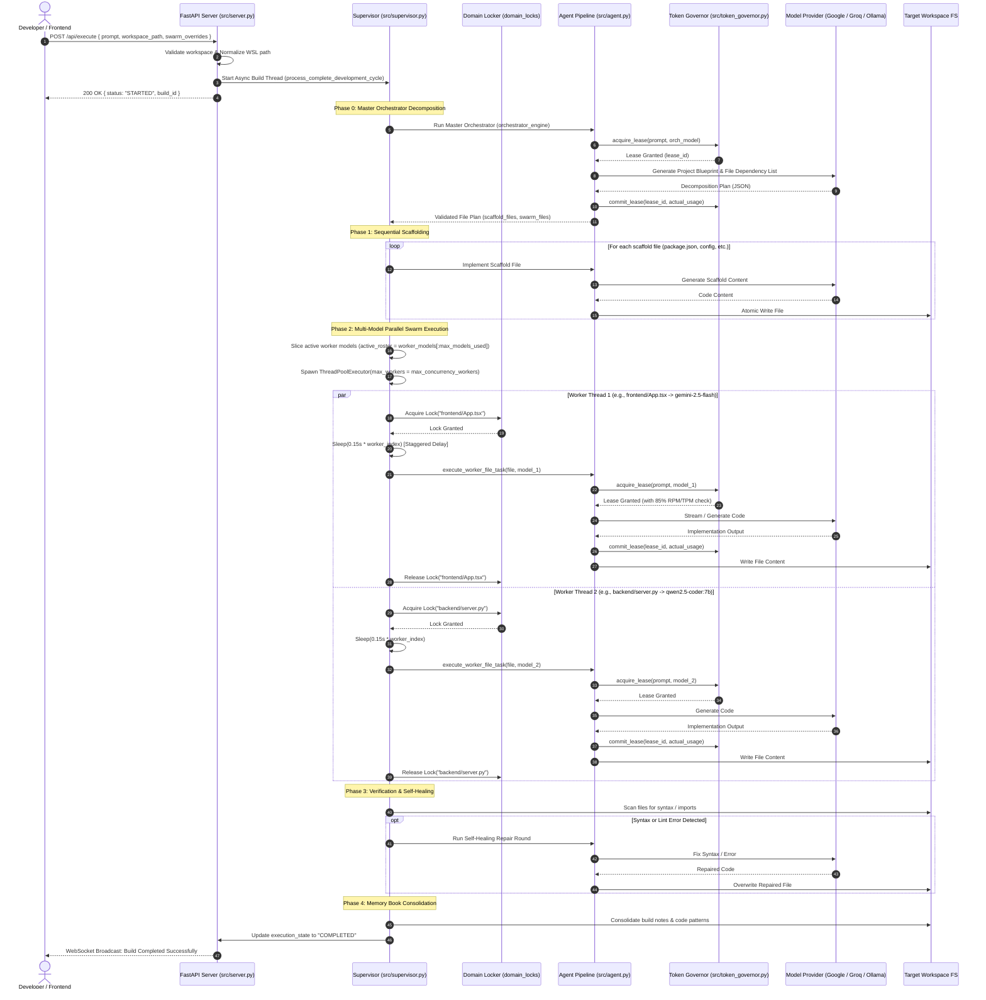
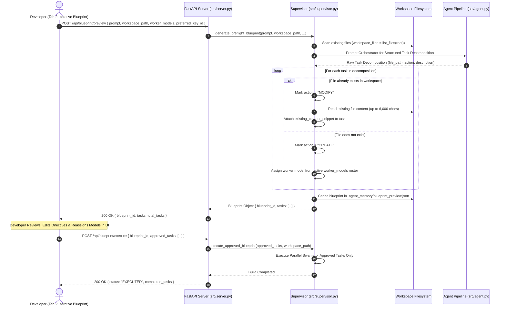
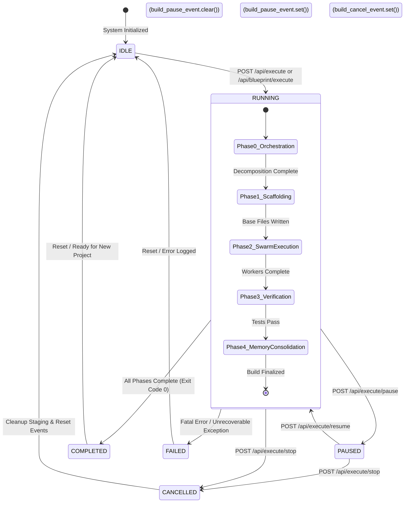
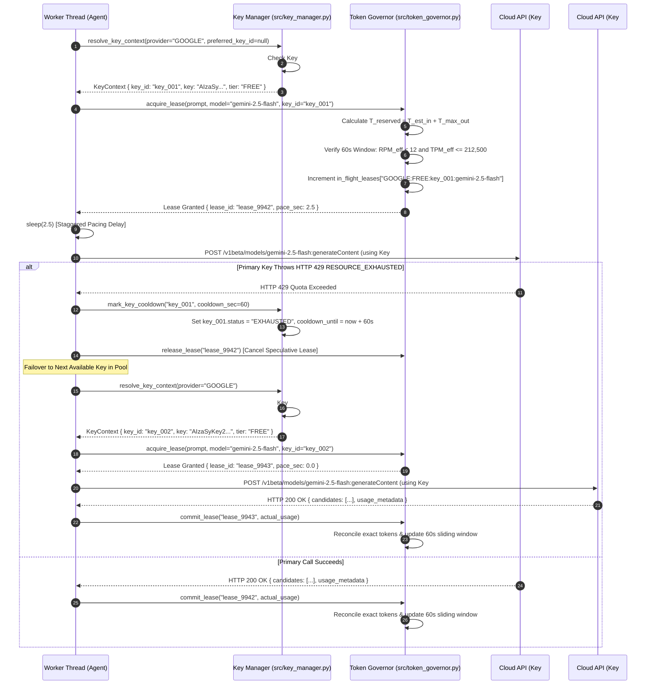
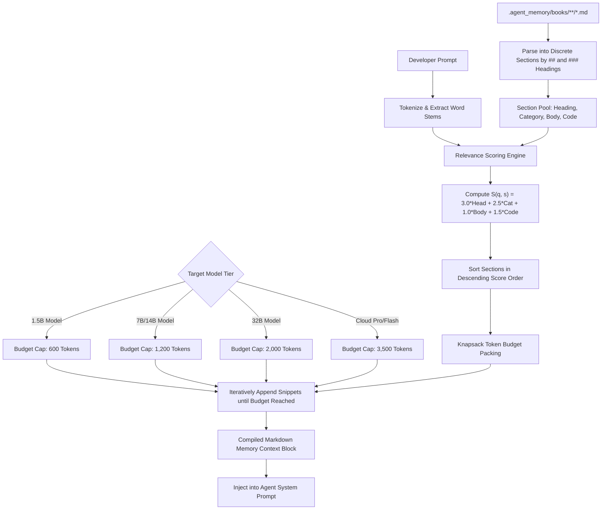
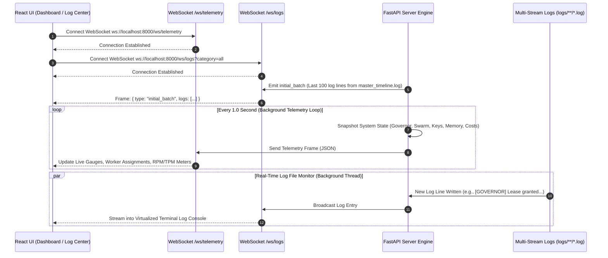

# ADVANCE ASSISTANT OS v6.0
## TECHNICAL SPECIFICATION 02: CORE OPERATIONAL PROCESS FLOWS & SEQUENCES

---

## 1. Process Flow 1: End-to-End Autonomous Project Build

### 1.1 Overview & Architectural Progression
An autonomous software build executes through 5 distinct sequential and parallel phases orchestrated by `src/supervisor.py`:
- **Phase 0: Master Orchestrator Decomposition**: The architectural model analyzes the prompt, inspects target workspace structure, and constructs a dependency graph of files to create and modify.
- **Phase 1: Sequential Scaffolding**: Critical infrastructure files (`package.json`, `requirements.txt`, core configurations) are created sequentially to establish the foundation.
- **Phase 2: Multi-Model Parallel Swarm Execution**: Worker threads execute concurrent file implementations using domain-specific file locking and staggered dispatching.
- **Phase 3: Verification & Automated Self-Healing**: Lints, static analysis, and syntax checkers execute against created files; errors trigger self-healing prompt rounds.
- **Phase 4: Memory Book Consolidation**: Key learnings, architectural blueprints, and recipes generated during the build are indexed into `.agent_memory/books/`.

### 1.2 Mermaid Sequence Diagram: Autonomous Project Build



### 1.3 Mermaid Flowchart: Phase Progression & Domain Locks

```mermaid
flowchart TD
    Start([User Initiates POST /api/execute]) --> Init[Validate & Normalize Workspace Path]
    Init --> Staging[Initialize Staging Isolation & Backup]
    Staging --> Phase0[Phase 0: Master Orchestrator Decomposition]

    Phase0 --> CheckPlan{Valid JSON Blueprint?}
    CheckPlan -- No --> RetryOrch[Re-prompt Orchestrator with Schema Error]
    RetryOrch --> Phase0
    CheckPlan -- Yes --> Phase1[Phase 1: Sequential Base Scaffolding]

    Phase1 --> ScaffFiles[Write package.json, requirements.txt, tsconfig.json]
    ScaffFiles --> Phase2[Phase 2: Multi-Model Parallel Swarm Execution]

    subgraph SwarmExecution ["Phase 2 Swarm Concurrency"]
        SliceRoster[Slice Worker Roster by max_models_used] --> ThreadPool[Initialize ThreadPoolExecutor]
        ThreadPool --> WorkerLoop{For each pending file in plan}
        WorkerLoop --> AssignModel[Round-Robin or Quota-Weighted Model Assignment]
        AssignModel --> StaggerDelay[Inject Staggered Delay: worker_id * 0.15s]
        StaggerDelay --> AcquireLock[Acquire Domain File Lock: domain_locks[path]]
        AcquireLock --> PreFlight[Token Governor: acquire_lease & 85% Rate Check]
        PreFlight --> CallModel[Model Provider Execution: Google / Groq / Ollama]
        CallModel --> PostFlight[Token Governor: commit_lease & Usage Update]
        PostFlight --> WriteDisk[Atomic File Write & Path Verify]
        WriteDisk --> ReleaseLock[Release Domain File Lock]
    end

    Phase2 --> SwarmExecution
    SwarmExecution --> Phase3[Phase 3: Automated Verification & Self-Healing]

    Phase3 --> LintCheck{Syntax / AST / Lint Clean?}
    LintCheck -- Errors Found --> HealingRound[Phase 3.1: Targeted Self-Healing with Error Trace]
    HealingRound --> LintCheck
    LintCheck -- All Clean --> Phase4[Phase 4: Knowledge Consolidation]

    Phase4 --> IndexMem[Index Build Learnings into .agent_memory/books/]
    IndexMem --> Finish([Build Lifecycle: COMPLETED])
```

---

## 2. Process Flow 2: Continuous Iterative Pre-Flight Blueprint & Approval Gate

### 2.1 Overview & Safety Gate Mechanics
The Iterative Blueprint workflow allows developers to preview, inspect, edit, and approve individual file implementation directives *before* any worker code generation begins:
1. `POST /api/blueprint/preview` scans target workspace files and decomposes the prompt into tasks.
2. The engine automatically differentiates between `CREATE` (new files) and `MODIFY` (existing files).
3. For `MODIFY` tasks, existing file contents (up to 6,000 characters) are extracted and injected into the task context.
4. The user can modify task directives, change the target file path, or re-assign specific models from the catalog.
5. `POST /api/blueprint/execute` consumes the approved blueprint and executes only the selected tasks.

### 2.2 Mermaid Sequence Diagram: Blueprint Preview & Approval



---

## 3. Process Flow 3: Build Lifecycle Control State Machine

### 3.1 Lifecycle States & Synchronization Events
Advance Assistant OS manages long-running builds using cooperative thread-safe events in `src/server.py` and `src/supervisor.py`:
- `build_pause_event = threading.Event()`: Set by default (`True`). Clearing it (`pause_event.clear()`) causes worker threads to pause immediately before acquiring leases. Setting it (`pause_event.set()`) resumes execution.
- `build_cancel_event = threading.Event()`: Cleared by default (`False`). Setting it (`cancel_event.set()`) instructs all active worker threads and supervisors to abort execution cleanly and release locks.

### 3.2 State Transition Diagram (Mermaid `stateDiagram-v2`)



---

## 4. Process Flow 4: Two-Phase Atomic Lease & Multi-Key Failover Sequence

### 4.1 Failover & Rate Limiting Mechanics
When an agent thread attempts an API call:
1. `key_manager.resolve_key_context()` selects the best key:
   - Evaluates `preferred_key_id` if specified by the user.
   - Verifies key status is `ACTIVE` and cooldown timestamp has expired.
   - Enforces `paid_tier_locked` financial shield.
   - Applies the active routing policy (`FREE_POOL`, `BALANCED`, `ROUND_ROBIN`, `PINNED`).
2. `token_governor.acquire_lease()` checks the key's 60-second sliding window and reserves worst-case capacity.
3. If an upstream 429 occurs, `key_manager.mark_key_cooldown()` puts the key into a temporary cooldown (e.g. 60s) and rotates to the next available key or falls back to local models.

### 4.2 Mermaid Sequence Diagram: Lease Acquisition, Execution & Failover



---

## 5. Process Flow 5: Live & Offline Model Synchronization Pipeline

### 5.1 Overview & Upstream Inspection
Triggered via `POST /api/governor/sync-models`, this pipeline queries all physical providers and local directories to build a unified catalog with mathematical 85% caps.

### 5.2 Mermaid Flowchart: Model Sync Pipeline

```mermaid
flowchart TD
    Trigger([Trigger: POST /api/governor/sync-models]) --> ParallelSync[Initiate Multi-Source Discovery]

    subgraph DiscoverySources ["Model Discovery Sources"]
        ParallelSync --> GoogleAPI[Query Google AI Studio:
GET /v1beta/models]
        ParallelSync --> GroqAPI[Query Groq Cloud LPU:
GET /v1/models]
        ParallelSync --> OllamaDaemon[Query Local Ollama Daemon:
GET /api/tags]
        ParallelSync --> LocalMatrix[Query Offline Test Matrix:
Ollama_Models_Testing]
    end

    GoogleAPI --> ParseGoogle[Filter active Gemini 2.x/3.x models
Extract RPM / TPM / RPD / Context Window]
    GroqAPI --> ParseGroq[Filter active LPU coding models
Extract 30 RPM / 6K TPM baseline]
    OllamaDaemon --> ParseOllama[Parse 76 local installed GGUF models
Match tags with capability benchmarks]
    LocalMatrix --> ParseMatrix[Attach VRAM requirement matrices
Attach coding benchmark scores]

    ParseGoogle --> Aggregate[Aggregate Raw Model Definitions]
    ParseGroq --> Aggregate
    ParseOllama --> Aggregate
    ParseMatrix --> Aggregate

    Aggregate --> Apply85[Apply compute_working_limits(strict_limits, margin=85%)]
    Apply85 --> CalcLimits[Compute:
RPM * 0.85
TPM * 0.85
RPD * 0.85
MaxInput * 0.85
MaxOutput * 0.85]
    CalcLimits --> SaveQuotas[Atomic Persist to .agent_memory/provider_quotas.json]
    SaveQuotas --> EmitToast[Return JSON Summary:
19 Google Free, 49 Google Paid,
4 Groq, 76 Local Ollama Models]
```

---

## 6. Process Flow 6: Precision Context Retrieval & Book Defragmentation

### 6.1 Context Extraction & Packing
1. The developer prompt is analyzed for tokens and programming language signatures.
2. The Memory Manager reads `.agent_memory/books/**/*.md` and extracts all `##` and `###` recipes.
3. Each recipe is scored using $S(q, s) = 3.0 \cdot 	ext{Match}_{	ext{heading}} + 2.5 \cdot 	ext{Match}_{	ext{cat}} + 1.0 \cdot 	ext{Match}_{	ext{body}} + 1.5 \cdot \mathbb{I}_{	ext{code}}$.
4. High-scoring recipes are packed into the target model's budget tier (e.g. 1,200 tokens for 7B models).
5. The compiled memory snippet block is prepended to the system prompt.

### 6.2 Flowchart: Precision Memory Lifecycle



---

## 7. Process Flow 7: Real-Time Dual WebSocket Telemetry & 6-Stream Log Tailing

### 7.1 Twin WebSocket Architecture
- **`/ws/telemetry` (1.0 Hz Push)**: Emits a comprehensive JSON frame containing execution state, active swarm profile, worker assignments, provider quotas, key pool metrics, token ledger accumulators, and cloud cost calculations.
- **`/ws/logs` (Event-Driven Tail Stream)**: Broadcasts multi-stream log entries in real-time as they are written to disk, filtering by category (`supervisor`, `gatekeeper`, `governor`, `router`, etc.) or specific model logs.

### 7.2 Mermaid Sequence Diagram: WebSocket Streaming


