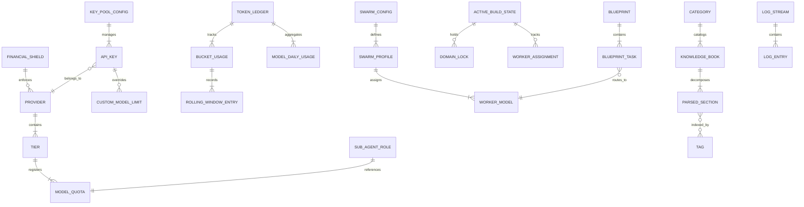

# ADVANCE ASSISTANT OS v6.0
## TECHNICAL SPECIFICATION 03: DATA FLOW DIAGRAMS (DFD) & ENTITY-RELATIONSHIP (ER) DATA DICTIONARY

---

## 1. Data Flow Diagrams (DFD)

### 1.1 DFD Level 0: System Context Diagram

The Context Diagram defines the external boundary of Advance Assistant OS v6.0, showing all external actors, external cloud systems, local hardware daemons, and storage systems that interact with the core operating system.

```mermaid
flowchart TD
    subgraph ExternalEntities ["External Entities & Environmental Boundaries"]
        UserBrowser["Developer / React 18 Web Console"]
        LegacyCLI["Developer Terminal / CI Runner (src/main.py)"]
        GoogleAPI["Google AI Studio Cloud (Gemini 2.5 / 3.6 API)"]
        GroqAPI["Groq Cloud LPU Service (Qwen 2.5 / Llama 3.3)"]
        OllamaDaemon["Local Ollama Daemon (http://127.0.0.1:11434)"]
        TestingSuite["Ollama_Models_Testing Benchmark Suite"]
        TargetFS["Target Project Filesystem (Workspace Root)"]
    end

    subgraph CoreSystem ["Advance Assistant OS v6.0 (System Boundary)"]
        OS["Advance Assistant OS Core Engine
(FastAPI Gateway, Supervisor, Agent Pipeline,
Token Governor, Key Manager, Memory Manager)"]
    end

    UserBrowser -->|Build Directives, Blueprint Edits, Key Inputs| OS
    OS -->|Real-Time Telemetry Frames, WebSocket Log Stream| UserBrowser

    LegacyCLI -->|Command-line Prompts, Local Flags| OS
    OS -->|Terminal Stdout / Stderr Stream| LegacyCLI

    OS -->|Model Inference Requests (Tokens, Prompts)| GoogleAPI
    GoogleAPI -->|Candidate Content, Token Usage Metadata| OS

    OS -->|Ultra-Low Latency Inference Requests| GroqAPI
    GroqAPI -->|Generated Code Tokens, HTTP 200/429 Status| OS

    OS -->|HTTP Inference Calls, keep_alive:0 Unload| OllamaDaemon
    OllamaDaemon -->|Streamed Local Tokens, Loaded Model Tags| OS

    TestingSuite -->|Raw VRAM & Accuracy Benchmark Matrices| OS

    OS -->|Atomic File Writes, AST/Syntax Lint Checks| TargetFS
    TargetFS -->|Existing Source Files, Workspace Directory Tree| OS
```

---

### 1.2 DFD Level 1: Major Subsystem Decomposition

The Level 1 DFD decomposes the system into its 8 core processes (`P1`–`P8`) and 9 persistent storage repositories (`D1`–`D9`), illustrating the exact flow of data between components.

```mermaid
flowchart TB
    subgraph Processes ["Subsystem Processes"]
        P1["P1: FastAPI Gateway & WebSocket Hub
(src/server.py)"]
        P2["P2: Project Supervisor & Blueprint Engine
(src/supervisor.py)"]
        P3["P3: Multi-Model Agent Pipeline
(src/agent.py)"]
        P4["P4: Hierarchical Token Governor
(src/token_governor.py)"]
        P5["P5: Multi-Provider Key Dispatcher
(src/key_manager.py)"]
        P6["P6: Precision Memory Engine
(src/memory_manager.py)"]
        P7["P7: VRAM & Testing Bridge Arbitrator
(src/testing_bridge.py)"]
        P8["P8: Multi-Stream Logger & Gatekeeper
(src/logger.py)"]
    end

    subgraph DataStores ["Persistent Storage Repositories (.agent_memory/)"]
        D1[("D1: provider_quotas.json
(85% Working Caps)")]
        D2[("D2: api_keys.json
(Key Matrix & Cooldowns)")]
        D3[("D3: token_ledger.json
(Sliding 60s & Daily Usage)")]
        D4[("D4: swarm_profiles.json
(Multi-Model Rosters)")]
        D5[("D5: sub_agents.json
(Specialist Role Profiles)")]
        D6[("D6: swarm_registry.json
(Live Worker Assignments)")]
        D7[("D7: blueprint_preview.json
(Task Decomposition Cache)")]
        D8[("D8: catalog_index.json & books/
(Recipe Snippets)")]
        D9[("D9: logs/**/*.log
(Master Timeline & Categories)")]
    end

    subgraph External ["External Surfaces"]
        ExtUser["Developer Client"]
        ExtCloud["Google / Groq Cloud APIs"]
        ExtOllama["Local Ollama & GPU"]
        ExtFS["Target Filesystem"]
    end

    ExtUser -->|HTTP / WebSocket| P1
    P1 -->|Telemetry / Logs| ExtUser

    P1 -->|Execute Request| P2
    P1 -->|Model Sync Request| P4
    P1 -->|Key Management| P5

    P2 -->|Read/Write Blueprint| D7
    P2 -->|Read Active Swarm| D4
    P2 -->|Write Active Worker Telemetry| D6
    P2 -->|Dispatch Task| P3

    P3 -->|Query Knapsack Memory| P6
    P6 -->|Search Index & Recipes| D8
    P6 -->>|Injected Markdown Snippets| P3

    P3 -->|Resolve Best Key| P5
    P5 -->|Read/Update Key Pool| D2
    P5 -->>|Masked Key Context| P3

    P3 -->|Acquire/Commit Lease| P4
    P4 -->|Enforce 85% Limits| D1
    P4 -->|Record 60s Window & Ledgers| D3
    P4 -->>|Lease & Pacing Delay| P3

    P3 -->|Hardware Check| P7
    P7 -->|VRAM GPU Telemetry| ExtOllama

    P3 -->|Execute Prompt| ExtCloud
    P3 -->|Execute Local Prompt| ExtOllama
    ExtCloud -->>|Tokens & Metadata| P3
    ExtOllama -->>|Local Tokens| P3

    P2 -->|Atomic File Writes| ExtFS
    ExtFS -->|Existing File Context| P2

    P1 & P2 & P3 & P4 & P5 -->|Structured Log Events| P8
    P8 -->|Write Category Logs| D9
    P8 -->|Broadcast Tail| P1
```

---

### 1.3 DFD Level 2: Deep-Dive — Token Governor, Per-Key Sliding Window & Swarm Model Dispatcher

This Level 2 DFD details the precise data interactions occurring during multi-model parallel task execution:

```mermaid
flowchart TD
    subgraph RequestContext ["1. Inbound Task Dispatch"]
        Task[Worker File Task] --> ExtractParams[Extract: prompt_chars, target_model, preferred_key_id]
    end

    subgraph KeyResolution ["2. Key Context Resolution (P5)"]
        ExtractParams --> CheckPref{preferred_key_id specified?}
        CheckPref -- Yes --> ValidatePref[Check if key active & not cooling]
        CheckPref -- No --> PolicyEngine[Apply Routing Policy: FREE_POOL / BALANCED]
        ValidatePref --> SelectedKey[Resolved: key_id, provider, tier, safety_margin]
        PolicyEngine --> SelectedKey
        SelectedKey --> ShieldCheck{Session Spend > Financial Cap?}
        ShieldCheck -- Yes --> LockPaid[Lock Paid Tier -> Fallback to Free / Local]
        ShieldCheck -- No --> OutputKeyContext[Active Key Context]
    end

    subgraph TwoPhaseLease ["3. Two-Phase Token Lease Protocol (P4)"]
        OutputKeyContext --> PreFlightCalc["Pre-Flight Calc:
T_est_in = len(prompt)/3.5
T_reserved = T_est_in + T_max_out + T_think"]
        PreFlightCalc --> BucketKey["Bucket Lookup:
{provider}:{tier}:{key_id}:{model}"]
        BucketKey --> SlidingWindowQuery["Query D3: Filter Window timestamps > (now - 60s)"]
        
        SlidingWindowQuery --> RateCheck{"Effective Rate Check:
RPM_eff = |W_60s| + |L_in_flight| < RPM_85
TPM_eff = sum(W_60s) + sum(L_in_flight) + T_res <= TPM_85"}
        
        RateCheck -- Limit Exceeded --> WaitPacing["Sleep until oldest window entry expires
or active lease commits"]
        WaitPacing --> SlidingWindowQuery

        RateCheck -- Capacity OK --> IssueLease["Create Lease Record (lease_id)
L_in_flight += T_reserved
Compute: pace = (60/RPM_85) * |L_in_flight|"]
    end

    subgraph ModelExecution ["4. Provider Execution"]
        IssueLease --> PacingSleep[Thread Sleep: pace_sec]
        PacingSleep --> DispatchCall[Dispatch Call to Cloud or Local Provider]
        DispatchCall --> ApiResponse[Receive Response & usage_metadata]
    end

    subgraph LeaseReconciliation ["5. Lease Commitment & Ledger Update"]
        ApiResponse --> ExtractUsage[Extract Exact: prompt_tokens, candidate_tokens, thought_tokens]
        ExtractUsage --> CommitLease["P4.commit_lease(lease_id, actual_usage)"]
        CommitLease --> ReleaseReserved["L_in_flight.remove(lease_id)
Add actual_usage to W_60s bucket
Update daily model accumulator in D3
Update financial spend tracking"]
        ReleaseReserved --> WriteResult[Write Code to Target Filesystem]
    end
```



---

## 2. Entity-Relationship (ER) Diagrams & Data Store Dictionary

### 2.1 Complete System ER Diagram (Mermaid `erDiagram`)



---

### 2.2 Data Store Data Dictionary

#### Data Store D1: `.agent_memory/provider_quotas.json`
Maintains strict API limits and working 85% caps across all providers, tiers, and models.

| Entity | Field Name | Data Type | Nullable | Description / Constraints |
| :--- | :--- | :--- | :---: | :--- |
| `FINANCIAL_SHIELD` | `session_token_cap` | Integer | No | Maximum allowed session tokens (default: 150,000) before paid tier locks. |
| | `session_cost_cap_usd` | Float | No | Maximum allowed dollar spend before paid tier lock. |
| | `paid_tier_locked` | Boolean | No | Dynamic circuit breaker flag; true if cap exceeded. |
| `PROVIDER` | `provider_name` | String | No | Provider key (`GOOGLE`, `GROQ`, `OLLAMA`). |
| `TIER` | `tier_name` | String | No | Tier key (`FREE`, `PAID`, `LOCAL`). |
| `MODEL_QUOTA` | `model_name` | String | No | Unique model identifier (`gemini-2.5-flash`, `qwen2.5-coder:7b`). |
| | `strict_limits.rpm` | Integer | No | Strict 100% provider requests-per-minute limit. |
| | `strict_limits.tpm` | Integer | No | Strict 100% provider tokens-per-minute limit. |
| | `strict_limits.rpd` | Integer | No | Strict 100% provider requests-per-day limit. |
| | `strict_limits.max_input_tokens` | Integer | No | Maximum context prompt input length. |
| | `strict_limits.max_output_tokens` | Integer | No | Maximum completion token generation limit. |
| | `working_limits.rpm` | Integer | No | 85% Working RPM cap ($\lfloor \text{strict-rpm} \times 0.85 \rfloor$). |
| | `working_limits.tpm` | Integer | No | 85% Working TPM cap ($\lfloor \text{strict-tpm} \times 0.85 \rfloor$). |
| | `working_limits.rpd` | Integer | No | 85% Working RPD cap ($\lfloor \text{strict-rpd} \times 0.85 \rfloor$). |
| | `working_limits.thinking_budget` | Integer | Yes | Optional dedicated reasoning token budget (e.g., Gemini 2.5 Think). |

---

#### Data Store D2: `.agent_memory/api_keys.json` (Git Ignored)
Stores persistent user API credentials, per-key health states, and dedicated per-key 85% overrides.

| Entity | Field Name | Data Type | Nullable | Description / Constraints |
| :--- | :--- | :--- | :---: | :--- |
| `KEY_POOL_CONFIG`| `routing_policy` | String | No | Active policy (`FREE_POOL`, `BALANCED`, `ROUND_ROBIN`, `PINNED`). |
| | `pinned_key_id` | String | Yes | Specific key ID to force if policy is `PINNED`. |
| `API_KEY` | `id` | String | No | Unique key identifier (e.g., `key_e7c36116`). |
| | `key` | String | No | Secret API key token (masked on all API & UI representations). |
| | `provider` | String | No | Provider identifier (`GOOGLE`, `GROQ`). |
| | `tier` | String | No | Subscription level (`FREE`, `PAID`). |
| | `label` | String | No | User-friendly human label (e.g., "Primary Workstation Key"). |
| | `status` | String | No | Health status (`ACTIVE`, `EXHAUSTED`, `INVALID`). |
| | `last_used` | Timestamp | Yes | ISO timestamp of most recent successful request dispatch. |
| | `error_count` | Integer | No | Consecutive error count; triggers auto-cooldown at 3. |
| | `cooldown_until` | Epoch Sec | No | Unix timestamp until which this key cannot be selected (0 = active). |
| | `safety_margin_percent` | Float | No | Per-key safety factor (default: 85.0%). |
| `CUSTOM_MODEL_LIMIT`| `model_name` | String | No | Model being overridden on this specific key. |
| | `working_limits` | Object | No | Key-dedicated working limits (`rpm`, `tpm`, `rpd`, `max_input`, `max_output`). |

---

#### Data Store D3: `.agent_memory/token_ledger.json`
Maintains the sliding 60-second in-memory windows and persistent daily consumption aggregates.

| Entity | Field Name | Data Type | Nullable | Description / Constraints |
| :--- | :--- | :--- | :---: | :--- |
| `TOKEN_LEDGER` | `updated_at` | Timestamp | No | ISO timestamp of the last ledger update. |
| `BUCKET_USAGE` | `bucket_key` | String | No | Composite identifier `{provider}:{tier}:{key_id}:{model}`. |
| `ROLLING_WINDOW_ENTRY`| `timestamp` | Float | No | High-resolution epoch timestamp ($t_i$) of the completed call. |
| | `tokens` | Integer | No | Actual total tokens consumed by this specific call. |
| `MODEL_DAILY_USAGE`| `model_name` | String | No | Unique model identifier. |
| | `requests_today` | Integer | No | Accumulated request count since 00:00:00 UTC. |
| | `input_tokens_today` | Integer | No | Accumulated prompt input tokens today. |
| | `output_tokens_today`| Integer | No | Accumulated generated output tokens today. |
| | `thinking_tokens_today`| Integer | No | Accumulated reasoning tokens today. |
| | `total_tokens_today` | Integer | No | Sum of input + output + thinking tokens today. |

---

#### Data Store D4: `.agent_memory/swarm_profiles.json`
Configures multi-model swarm topologies, active rosters, concurrency limits, and dispatch routing.

| Entity | Field Name | Data Type | Nullable | Description / Constraints |
| :--- | :--- | :--- | :---: | :--- |
| `SWARM_CONFIG` | `active_swarm_id` | String | No | ID of active profile (`GLOBAL_HYBRID_SWARM`, etc.). |
| | `orchestrator_engine`| String | No | Active Master Orchestrator model (`gemini-2.5-pro`, `qwen2.5-coder:32b`). |
| | `worker_models` | Array[Str]| No | Ordered candidate roster of worker models (`1 to N`). |
| | `max_models_used` | Integer | No | Maximum distinct models concurrently engaged from roster ($1 \le N \le |\mathcal{R}|$). |
| | `max_concurrency_workers`| Integer | No | Parallel worker thread ceiling ($1 \le W \le 16$, default 6). |
| | `routing_strategy` | String | No | Roster dispatch mode (`ROUND_ROBIN`, `QUOTA_WEIGHTED`). |
| | `preferred_key_id` | String | No | Pinned key ID or `"AUTO"` for pool resolution. |
| `SWARM_PROFILE` | `id` | String | No | Profile identifier key. |
| | `name` | String | No | Display name of the swarm topology. |
| | `description` | String | No | Architectural capability narrative. |
| | `default_orchestrator`| String | No | Default orchestrator model. |
| | `default_workers` | Array[Str]| No | Pre-configured worker roster for this preset. |

---

#### Data Store D5: `.agent_memory/sub_agents.json`
Configures domain specialist roles, system instructions, and preferred tool configurations.

| Entity | Field Name | Data Type | Nullable | Description / Constraints |
| :--- | :--- | :--- | :---: | :--- |
| `SUB_AGENT_ROLE` | `role_id` | String | No | Unique role identifier (`architect`, `coder`, `tester`, `reviewer`). |
| | `name` | String | No | Human-readable persona title. |
| | `model` | String | No | Dedicated default model for this role. |
| | `temperature` | Float | No | Inference temperature setting ($0.0 \le T \le 1.0$). |
| | `system_prompt` | String | No | Specialist persona instruction template. |
| | `allowed_tools` | Array[Str]| No | Permitted execution tools and bridges. |

---

#### Data Store D6: `.agent_memory/swarm_registry.json`
Maintains live in-flight execution telemetry for active builds.

| Entity | Field Name | Data Type | Nullable | Description / Constraints |
| :--- | :--- | :--- | :---: | :--- |
| `ACTIVE_BUILD_STATE` | `build_id` | String | No | Active execution session UUID. |
| | `status` | String | No | Execution state (`IDLE`, `RUNNING`, `PAUSED`, `COMPLETED`, `CANCELLED`). |
| | `active_orchestrator` | String | Yes | Model currently executing Phase 0 or task decomposition. |
| | `active_worker_models`| Array[Str]| No | Subset of models actively assigned to worker threads. |
| `DOMAIN_LOCK` | `file_path` | String | No | Relative normalized file path currently locked by a worker. |
| | `worker_id` | String | No | Identifier of the worker thread holding the lock. |
| | `acquired_at` | Epoch Sec | No | Timestamp when the lock was acquired. |
| `WORKER_ASSIGNMENT` | `file_path` | String | No | Target file currently being generated. |
| | `worker_id` | String | No | Worker thread index. |
| | `model_name` | String | No | Specific model generating the code. |
| | `phase` | String | No | Active development phase (`PHASE_2_SWARM`). |

---

#### Data Store D7: `.agent_memory/blueprint_preview.json`
Stores the iterative pre-flight blueprint and task modifications awaiting developer approval.

| Entity | Field Name | Data Type | Nullable | Description / Constraints |
| :--- | :--- | :--- | :---: | :--- |
| `BLUEPRINT` | `blueprint_id` | String | No | Unique blueprint session ID (e.g., `bp_1792326982`). |
| | `created_at` | Timestamp | No | ISO creation timestamp. |
| | `workspace_path` | String | No | Target project root directory. |
| | `total_tasks` | Integer | No | Count of tasks in the blueprint. |
| `BLUEPRINT_TASK` | `task_id` | String | No | Unique task index (e.g., `task_1`). |
| | `file_path` | String | No | Target relative file path. |
| | `action` | String | No | Operation type (`CREATE` or `MODIFY`). |
| | `description` | String | No | Architectural instruction narrative. |
| | `assigned_model` | String | No | Model assigned to implement this task. |
| | `existing_content_snippet` | String | Yes | Up to 6,000 characters of existing code for `MODIFY` tasks. |
| | `is_approved` | Boolean | No | Developer execution approval flag. |

---

#### Data Store D8: `.agent_memory/catalog_index.json` & `.agent_memory/books/**/*.md`
Indexes precision memory snippets extracted from domain-specific Markdown knowledge books.

| Entity | Field Name | Data Type | Nullable | Description / Constraints |
| :--- | :--- | :--- | :---: | :--- |
| `CATEGORY` | `category_name` | String | No | Domain folder (`coding`, `architecture`, `debugging`, `governance`). |
| `KNOWLEDGE_BOOK`| `book_name` | String | No | Markdown book filename (e.g., `fastapi_patterns.md`). |
| | `file_path` | String | No | Full relative path on disk. |
| | `total_sections` | Integer | No | Count of parsed discrete `##` and `###` recipes. |
| | `estimated_tokens`| Integer | No | Total token footprint of the book. |
| `PARSED_SECTION`| `section_id` | String | No | Unique composite hash of the section. |
| | `heading` | String | No | Title of the section (`##` or `###`). |
| | `body` | String | No | Core instruction narrative. |
| | `code_blocks` | Array[Str]| No | Extracted executable code blocks. |
| | `token_count` | Integer | No | Estimated tokens for this discrete recipe. |
| `TAG` | `tag_name` | String | No | Keyword stem for inverted index lookups. |

---

#### Data Store D9: `logs/**/*.log`
Multi-stream audit trail and telemetry log files.

| Entity | File Path / Pattern | Stream Type | Retention / Format |
| :--- | :--- | :--- | :--- |
| `MASTER_TIMELINE` | `logs/master_timeline.log` | Unified Audit Log | Append-only chronological system stream. |
| `DAILY_LOG` | `logs/daily/YYYY-MM-DD.log` | Partitioned Daily | Daily date-partitioned system log. |
| `CATEGORY_LOG` | `logs/categories/{cat}/*.log`| Category Specific | Partitioned by `supervisor`, `gatekeeper`, `governor`, `router`. |
| `MODEL_LOG` | `logs/categories/models/*.log`| Model Specific | Per-model execution output stream. |
| `PROJECT_TRACE` | `logs/projects/{id}/trace.log`| Build Trace | Project-isolated execution trace. |
