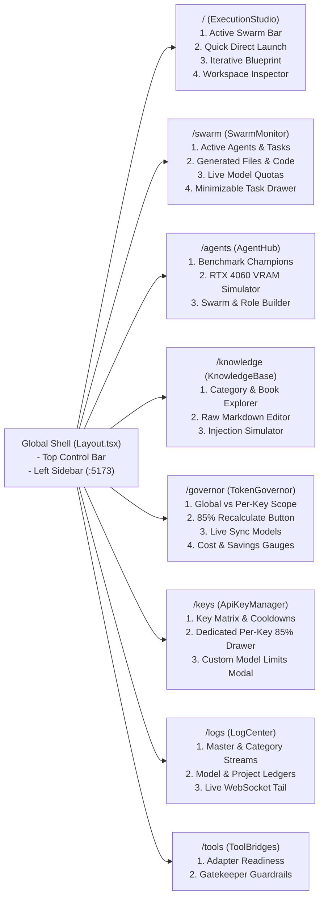

# ADVANCE ASSISTANT OS v6.0
## TECHNICAL SPECIFICATION 05: WEB CONSOLE VISUAL GUIDE & OPERATIONAL PLAYBOOK

---

## 1. Global Navigation & Architecture Map

The Advance Assistant OS v6.0 Web Console is a high-performance React 18 single-page application built on Vite, Tailwind CSS, Lucide icons, and real-time dual WebSockets.

### 1.1 Console Navigation Map (Mermaid `graph LR`)



---

## 2. Global Top Control Bar (`src/components/Layout.tsx`)

### 2.1 Visual ASCII Wireframe
```
+-----------------------------------------------------------------------------------------------------------------------------------------+
| [⚡ ADVANCE ASSISTANT OS v6.0]  [🟢 RUNNING: build_84719]  [🔑 Policy: FREE_POOL v]  [🛡️ 85% CAP ACTIVE]  [⏸️ Pause] [⏹️ Stop]  [📋 Logs] |
+-----------------------------------------------------------------------------------------------------------------------------------------+
| SIDEBAR       | ACTIVE VIEW CONTENT AREA                                                                                                |
| [🚀 Studio]   |                                                                                                                         |
| [⚡ Swarm]    |                                                                                                                         |
| [🤖 Agents]   |                                                                                                                         |
| [📚 Memory]   |                                                                                                                         |
| [🛡️ Governor] |                                                                                                                         |
| [🔑 Keys]     |                                                                                                                         |
| [📋 Logs]     |                                                                                                                         |
| [🔌 Tools]    |                                                                                                                         |
+---------------+-------------------------------------------------------------------------------------------------------------------------+
```

### 2.2 Control Bar Operational Playbook
1. **Key Routing Policy Selector**:
   - Allows instant switching between `FREE_POOL` (strictly free keys), `BALANCED` (optimizes speed & remaining daily tokens), `ROUND_ROBIN`, and `PINNED`.
2. **Paid Tier Lock Toggle (`🔒 Paid Locked`)**:
   - Displays the current Financial Shield status. When locked, all requests are bounded to the Free pool or local offline models.
3. **Build Lifecycle Controls**:
   - `[⏸️ Pause]`: Temporarily holds all active worker threads at the pre-lease checkpoint.
   - `[▶️ Resume]`: Releases worker threads to continue execution.
   - `[⏹️ Stop]`: Immediately cancels the active build and releases file locks.
4. **Log Center Quick-Jump**:
   - Clicking `[📋 Logs]` navigates directly to `/logs`, preserving current filter context.

---

## 3. View 1: Execution Studio (`/`)

### 3.1 Visual ASCII Wireframe
```
+-----------------------------------------------------------------------------------------------------------------------------------------+
| ACTIVE SWARM & MODEL ROSTER BAR                                                                                                         |
| Preset: [GLOBAL_HYBRID_SWARM v] | Orch: [☁️ Gemini 2.5 Pro (85% Cap) v] | Workers: [🤖 3/3 Active] | Key: [🔑 AUTO Pool v] | [⚙️ Customize] |
| +-------------------------------------------------------------------------------------------------------------------------------------+ |
| | COLLAPSIBLE WORKER ROSTER DRAWER (Filters: [ALL] [GOOGLE FREE] [GOOGLE PAID] [GROQ] [OLLAMA LOCAL])                                | |
| | [x] gemini-2.5-flash (12 RPM)   [x] qwen2.5-coder:7b (102 RPM)   [x] llama-3.3-70b (25 RPM)  | Max Models: [ 3 ] | Strategy: [ROUND_ROBIN]| |
| | [💾 Save as Default Swarm Roster]                                                                                                   | |
| +-------------------------------------------------------------------------------------------------------------------------------------+ |
+-----------------------------------------------------------------------------------------------------------------------------------------+
| [ Tab 1: 🚀 Quick Direct Launch ]    [ Tab 2: 🧭 Iterative Blueprint & Dry-Run ]    [ Tab 3: 📂 Workspace Files & Code Inspector ]     |
+-----------------------------------------------------------------------------------------------------------------------------------------+
| Target Workspace: [/home/assistantuser/advance_assistant/sandbox/fastapi_demo] [Scan Workspace]                                         |
| Build Prompt:                                                                                                                           |
| +-------------------------------------------------------------------------------------------------------------------------------------+ |
| | Create a scalable FastAPI backend with PostgreSQL models, async repos, and pytest test suites...                                    | |
| +-------------------------------------------------------------------------------------------------------------------------------------+ |
| [🚀 Execute Autonomous Build]                                                                                                           |
+-----------------------------------------------------------------------------------------------------------------------------------------+
```

### 3.2 Operational Playbook
- **Active Swarm Bar**: Switch topologies instantly or expand `[⚙️ Customize]` to toggle candidate models into the active roster.
- **Tab 1 (Quick Direct Launch)**: Executes Phase 0 through Phase 4 in a single uninterrupted autonomous pipeline.
- **Tab 2 (Iterative Blueprint & Dry-Run)**:
  1. Click `[🧭 Generate Blueprint Preview]`.
  2. Inspect decomposed tasks (`CREATE` vs `MODIFY`).
  3. Edit task descriptions, adjust file paths, or re-assign models via the catalog dropdown.
  4. Click `[🚀 Execute Approved Blueprint Tasks]`.
- **Tab 3 (Workspace Inspector)**: Explore file trees, check syntax, and read files safely with built-in path-traversal blocks.

---

## 4. View 2: Live Swarm Monitor (`/swarm`)

### 4.1 Visual ASCII Wireframe
```
+-----------------------------------------------------------------------------------------------------------------------------------------+
| [ Tab 1: ⚡ Active Agents & Tasks ]      [ Tab 2: 📄 Generated Files & Code ]      [ Tab 3: 📊 Live Model Quotas ]                      |
+-----------------------------------------------------------------------------------------------------------------------------------------+
| SWARM CONCURRENCY: [6 Workers Active] | ORCHESTRATOR: [gemini-2.5-pro] | DOMAIN LOCKS: [backend/main.py (Worker 0)]                     |
|                                                                                                                                         |
| +-------------------------+ +-------------------------+ +-------------------------+ +-------------------------------------------------+ |
| | Worker 0: gemini-2.5-fl | | Worker 1: qwen2.5-coder | | Worker 2: llama-3.3-70b | | AGENT TASK DRAWER (Minimizable)                 | |
| | File: backend/main.py   | | File: backend/models.py | | File: backend/auth.py   | | Active: backend/main.py                         | |
| | Status: 🟢 In-Flight    | | Status: 🟢 In-Flight    | | Status: 🟡 Pacing Sleep | | Model: gemini-2.5-flash                         | |
| | Tokens: 4,120 / 8,192   | | Tokens: 6,800 / 14,000  | | Pace Delay: 2.5s        | | Lease: lease_9912 | Lock: ACQUIRED              | |
| +-------------------------+ +-------------------------+ +-------------------------+ +-------------------------------------------------+ |
|                                                                                                                                         |
| LIVE GENERATED CODE VIEWER (Real-Time File Content Inspection)                                                                          |
| File: backend/main.py                                                                                                                   |
| ```python                                                                                                                               |
| from fastapi import FastAPI                                                                                                             |
| app = FastAPI(title="Generated System")                                                                                                 |
| ```                                                                                                                                     |
+-----------------------------------------------------------------------------------------------------------------------------------------+
```

### 4.2 Operational Playbook
- **Active Agents & Tasks**: Monitor thread workers, assigned files, and active lease token counts in real time.
- **Generated Files & Code**: Click any completed or in-progress file to view syntax-highlighted code output.
- **Live Model Quotas Tab**: Monitor rolling 60s RPM/TPM meters updating at 1 Hz via `/ws/telemetry`.

---

## 5. View 3: Agent & Model Intelligence Hub (`/agents`)

### 5.1 Visual ASCII Wireframe
```
+-----------------------------------------------------------------------------------------------------------------------------------------+
| [ Tab 1: 🏆 Empirical Benchmark Champions ]  [ Tab 2: 🎮 RTX 4060 VRAM Arbitrator ]  [ Tab 3: 🛠️ Swarm & Role Builder ]                 |
+-----------------------------------------------------------------------------------------------------------------------------------------+
| NVIDIA GeForce RTX 4060 Laptop GPU (8.0 GB GDDR6 Dedicated VRAM)                                                                        |
| VRAM Allocation Gauge: [||||||||||||||||....................] 4.8 GB / 8.0 GB (Headroom: 3.2 GB) | Safety Tier: [🟢 SAFE_GPU]            |
| [🧹 Scavenge Idle VRAM (keep_alive: 0)]                                                                                                  |
|                                                                                                                                         |
| MULTI-MODEL WORKER ROSTER BUILDER                                                                                                       |
| Filter by: [GOOGLE FREE] [GOOGLE PAID] [GROQ] [OLLAMA LOCAL]                                                                             |
| +-------------------------------------------------------------------------------------------------------------------------------------+ |
| | [x] qwen2.5-coder:7b     | Strict: 120 RPM • 500K TPM | 85% Cap: 102 RPM • 425K TPM | VRAM: 4.8 GB [SAFE_GPU]                           | |
| | [x] gemini-2.5-flash     | Strict:  15 RPM • 250K TPM | 85% Cap:  12 RPM • 212K TPM | Cloud Multimodal Free Tier                        | |
| | [ ] qwen2.5-coder:32b    | Strict:  30 RPM • 200K TPM | 85% Cap:  25 RPM • 170K TPM | VRAM: 14.2 GB [PAGED_HYBRID]                      | |
| +-------------------------------------------------------------------------------------------------------------------------------------+ |
| Selected Workers: [2 Models Selected] | Max Concurrency: [ 6 ] | Routing: [ROUND_ROBIN v] | Preferred Key: [AUTO v]                     |
| [💾 Save & Activate Swarm Roster]                                                                                                       |
+-----------------------------------------------------------------------------------------------------------------------------------------+
```

### 5.2 Operational Playbook
- **Tab 1 (Benchmark Champions)**: Review empirical code quality ratings, token throughput (tok/sec), and recommended use-cases.
- **Tab 2 (RTX 4060 VRAM Arbitrator)**: Inspect physical GPU memory, verify safety tiers, and scavenge idle models with `[🧹 Scavenge Idle VRAM]`.
- **Tab 3 (Swarm & Role Builder)**: Construct bespoke multi-model swarms, pick candidate workers, and save rosters into `.agent_memory/swarm_profiles.json`.

---

## 6. View 4: Knowledge Base Workspace (`/knowledge`)

### 6.1 Visual ASCII Wireframe
```
+-----------------------------------------------------------------------------------------------------------------------------------------+
| KNOWLEDGE CATEGORIES              | BOOK EXPLORER: coding / fastapi_patterns.md                                                         |
| > ai_ml (3 books)                 | Total Sections: 8 | Estimated Tokens: 1,840 | [✏️ Edit Markdown] [➕ Append Recipe]                      |
| v coding (6 books)                | +-------------------------------------------------------------------------------------------------+ |
|   - fastapi_patterns.md           | | ## Async Database Repositories                                                                  | |
|   - react_guidelines.md           | | Always yield sessions using asynccontextmanager to guarantee pool release...                    | |
|   - python_typing.md              | | ```python                                                                                       | |
| > architecture (4 books)          | | @asynccontextmanager                                                                            | |
| > devops (2 books)                | | async def get_session(): ...                                                                    | |
| > governance (2 books)            | | ```                                                                                             | |
|                                   | +-------------------------------------------------------------------------------------------------+ |
+-----------------------------------+-----------------------------------------------------------------------------------------------------+
| PRECISION CONTEXT INJECTION SIMULATOR                                                                                                   |
| Query: [Implement async session manager for postgres] | Target Model: [7B / 14B (1,200 Tok Cap) v] | [⚡ Run Injection Simulation]      |
| Result: Injected 11 snippets (1,180 / 1,200 tokens) | Saved 15,620 tokens (92.9% reduction vs full book injection)                       |
+-----------------------------------------------------------------------------------------------------------------------------------------+
```

### 6.2 Operational Playbook
- **Section Explorer**: Expand categories and books; click sections to review structured recipes and code blocks.
- **Raw Markdown Editor & Recipe Appender**: Directly edit or append operational recipes without leaving the browser.
- **Context Injection Simulator**: Validate that specific user prompts retrieve appropriate recipes within target token caps.

---

## 7. View 5: Hierarchical Token Governor (`/governor`)

### 7.1 Visual ASCII Wireframe
```
+-----------------------------------------------------------------------------------------------------------------------------------------+
| TOP ACTION BAR                                                                                                                          |
| Scope: [🌐 Global Provider/Tier Quotas v] | [🔄 Sync Live & DB Models] | [📐 Apply 85% Working Limits] | Margin %: [ 85 ]                |
+-----------------------------------------------------------------------------------------------------------------------------------------+
| FINANCIAL SHIELD & COST VALUATION                                                                                                       |
| Spend: $0.042 (₹3.53) | Cloud Value Saved: $1.250 (₹105.00) | Paid Tokens: 42,000 | Free/Local Tokens: 970,000                          |
+-----------------------------------------------------------------------------------------------------------------------------------------+
| MODEL QUOTA CARDS (Scope: GLOBAL)                                                                                                       |
| +-----------------------------------------------+ +-----------------------------------------------+                                     |
| | gemini-2.5-flash (GOOGLE • FREE)              | | qwen2.5-coder:7b (OLLAMA • LOCAL)             |                                     |
| | 85% Cap:   12 RPM • 212K TPM • 425 RPD        | | 85% Cap:  102 RPM • 425K TPM •  85K RPD       |                                     |
| | Strict:    15 RPM • 250K TPM • 500 RPD        | | Strict:   120 RPM • 500K TPM • 100K RPD       |                                     |
| | Today: 14 Reqs | 52,100 Toks (In: 32K Out: 20K)| | Today: 42 Reqs | 184,000 Toks                 |                                     |
| | [✏️ Edit Limits]                               | | [✏️ Edit Limits]                               |                                     |
| +-----------------------------------------------+ +-----------------------------------------------+                                     |
+-----------------------------------------------------------------------------------------------------------------------------------------+
```

### 7.2 Operational Playbook
- **Dedicated Key Scope Dropdown**: Switch between Global Provider Limits and Dedicated Per-Key Quotas (`Key #1`, `Key #2`, etc.).
- **Live Sync & Recalculate**: Click `[🔄 Sync Live & DB Models]` to discover upstream models or `[📐 Apply 85% Working Limits]` to reset working caps.
- **Model Limit Editor Modal**: Customize individual model parameters; use `[⚡ Auto-Fill 85% of Strict]` for instant mathematical recalculation.

---

## 8. View 6: Multi-Provider API Key Manager (`/keys`)

### 8.1 Visual ASCII Wireframe
```
+-----------------------------------------------------------------------------------------------------------------------------------------+
| [➕ Register New Key]  |  Routing Policy: [FREE_POOL v]  |  Total Keys: [ 4 ]  |  Active: [ 4 ]  |  Cooling: [ 0 ]                       |
+-----------------------------------------------------------------------------------------------------------------------------------------+
| REGISTERED KEYS MATRIX                                                                                                                  |
| [>] AIzaSy...4xQ1  | GOOGLE • FREE | Primary Free Key  | 🛡️ 85% Cap | 📊 14 reqs | 🟢 ACTIVE | [⚡ Test] [Actions v]                    |
| v   AIzaSy...9eA2  | GOOGLE • FREE | Secondary Free Key| 🛡️ 85% Cap | 📊  8 reqs | 🟢 ACTIVE | [⚡ Test] [Actions v]                    |
| +-------------------------------------------------------------------------------------------------------------------------------------+ |
| | EXPANDED KEY DRAWER: Dedicated Per-Key Model Quotas & 85% Working Limits                                                            | |
| | Safety Margin: [ 85% ] [Change Margin %] | Requests Today: 8 | In: 24,100 | Out: 12,400 | Thinking: 0                               | |
| | Models Configured on Key:                                                                                                           | |
| | - gemini-2.5-flash: 85% Cap: 12 RPM • 212K TPM | Today: 8 reqs | [✏️ Customize Model Limit]                                          | |
| | - gemini-3.6-flash: 85% Cap: 12 RPM • 212K TPM | Today: 0 reqs | [✏️ Customize Model Limit]                                          | |
| +-------------------------------------------------------------------------------------------------------------------------------------+ |
| [>] gsk_x8...9K    | GROQ • FREE   | Groq LPU Fast Key | 🛡️ 85% Cap | 📊 22 reqs | 🟢 ACTIVE | [⚡ Test] [Actions v]                    |
+-----------------------------------------------------------------------------------------------------------------------------------------+
```

### 8.2 Operational Playbook
- **Key Registration & Testing**: Add keys with auto-detected provider prefixes (`AIza...` or `gsk_...`) and click `[⚡ Test]` to verify latency.
- **Expanded Key Drawer**: Inspect discrete per-key token metrics (Input, Output, Thinking) and update key safety margin percent.
- **Dedicated Key Limit Customizer**: Save custom limits that apply strictly when that specific key is selected.

---

## 9. View 7: Full-Screen 6-Stream Log Center (`/logs`)

### 9.1 Visual ASCII Wireframe
```
+-----------------------------------------------------------------------------------------------------------------------------------------+
| LOG SOURCE: [Master Timeline v] | SEVERITY: [ALL v] | AUTO-SCROLL: [x] | TOTAL LINES: [ 1,420 ] | [📥 Export Logs] | [🗑️ Clear View]     |
| Sub-Streams: [Master] [Daily] [Supervisor] [Governor] [Gatekeeper] [Router] [Models v] [Projects v]                                     |
+-----------------------------------------------------------------------------------------------------------------------------------------+
| VIRTUALIZED LOG CONSOLE                                                                                                                 |
| 2026-10-18 17:20:00.12 [INFO]  [GOVERNOR]   Lease lease_9912 granted for gemini-2.5-flash (T_reserved=4,200)                            |
| 2026-10-18 17:20:00.27 [INFO]  [SUPERVISOR] Worker 0 acquired domain lock on backend/main.py                                           |
| 2026-10-18 17:20:02.84 [INFO]  [GATEKEEPER] File write verified: backend/main.py (142 lines, 4,210 bytes)                               |
| 2026-10-18 17:20:02.91 [INFO]  [GOVERNOR]   Lease lease_9912 committed (actual_tokens=3,840, reconciled=360)                             |
| 2026-10-18 17:20:03.05 [WARN]  [ROUTER]     Key key_001 approaching 80% daily quota (340 / 425 RPD)                                    |
+-----------------------------------------------------------------------------------------------------------------------------------------+
```

### 9.2 Operational Playbook
- **Source Filtering**: Switch effortlessly between the unified Master Timeline, daily files, category logs, or isolated project traces.
- **Interactive JSON Inspection**: Click any structured log line to inspect its raw JSON metadata and timing details.
- **Blueprint Ledgers**: Select past projects from the project dropdown to review their complete task execution ledger.

---

## 10. View 8: Tool Bridges & Gatekeeper Security (`/tools`)

### 10.1 Visual ASCII Wireframe
```
+-----------------------------------------------------------------------------------------------------------------------------------------+
| EXTERNAL TOOL BRIDGES                                             | GATEKEEPER SECURITY GUARDRAILS                                      |
| +---------------------------------------------------------------+ | +-----------------------------------------------------------------+ |
| | Aider Pair-Programming Bridge       [🟢 CONNECTED / READY]    | | | File Write Sandbox Guard               [🟢 ACTIVE / ENFORCING]    | |
| | Binary: /home/assistantuser/.local/bin/aider                  | | | Sandbox Root: /home/assistantuser/advance_assistant               | |
| +---------------------------------------------------------------+ | +-----------------------------------------------------------------+ |
| | RooCode / Cline IPC Socket          [🟢 LISTENING]            | | | Path Traversal Protection              [🟢 ACTIVE / REJECTING ..] | |
| | Socket: /tmp/roocode_ipc.sock                                 | | | Rejects any escape above workspace root                       | |
| +---------------------------------------------------------------+ | +-----------------------------------------------------------------+ |
| | N8N Autonomous Webhook              [🟢 READY]                | | | Sensitive Credential Shield            [🟢 ACTIVE / BLOCKING]     | |
| | URL: http://localhost:5678/webhook/advance-assistant-task     | | | Blocks read/write to .env, *key*, *secret*, api_keys.json     | |
| +---------------------------------------------------------------+ | +-----------------------------------------------------------------+ |
| | Antigravity MCP Server              [🟢 PORT 8080 READY]      | | | AST Syntax & Lint Validator            [🟢 ACTIVE / PRE-FLIGHT]   | |
| | Exposing 22 MCP Tools to IDE Agents                           | | | Pre-validates syntax before committing files to target FS     | |
| +---------------------------------------------------------------+ | +-----------------------------------------------------------------+ |
+-----------------------------------------------------------------------------------------------------------------------------------------+
```

### 10.2 Operational Playbook
- **Bridge Status**: Check connection state for Aider, RooCode, N8N, Antigravity MCP, Vision, and Voice adapters.
- **Gatekeeper Inspection**: Review active security policies protecting the host filesystem from path traversal, credential leaks, and syntax corruption.
