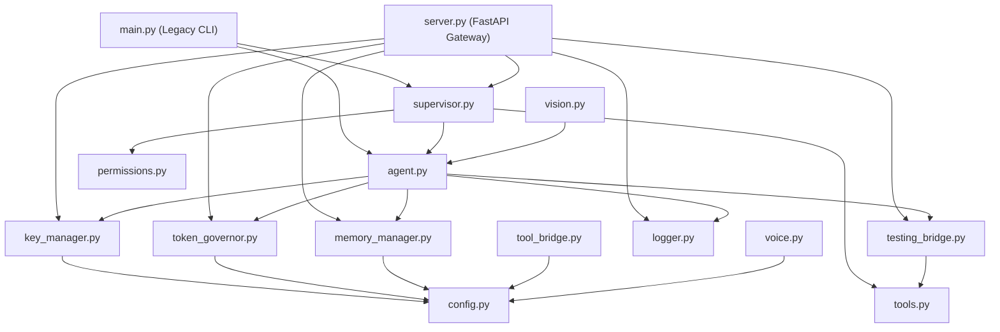

# ADVANCE ASSISTANT OS v6.0 — CORE PYTHON ENGINE (`src/`)

## 1. Architectural Overview & Component Inventory

The `src/` directory contains the complete backend orchestration, model dispatching, token governance, memory retrieval, hardware arbitration, and server gateway logic for Advance Assistant OS v6.0.

### Module Inventory (15 Core Python Files)

| Module File | Lines / Size | Primary Class / Functions | Operational Responsibility |
| :--- | :--- | :--- | :--- |
| **[`main.py`](file:///home/assistantuser/advance_assistant/src/main.py)** | 15.4 KB | `main()`, `run_cli()` | **Legacy CLI Entrypoint**: Interactive terminal REPL, single-pass build runner. Subject to the **Zero-Mutation CLI Preservation Contract**. |
| **[`server.py`](file:///home/assistantuser/advance_assistant/src/server.py)** | 81.7 KB | `FastAPI app`, Background Threads | **API Gateway & WebSocket Streamer**: Exposes 35+ REST endpoints, twin WebSockets (`/ws/telemetry`, `/ws/logs`), and cooperative build lifecycle management (`build_pause_event`, `build_cancel_event`). |
| **[`supervisor.py`](file:///home/assistantuser/advance_assistant/src/supervisor.py)** | 42.7 KB | `ProjectSupervisor` | **Project Orchestrator & Swarm Dispatcher**: Drives Phase 0 (Decomposition), Phase 1 (Scaffolding), Phase 2 (Parallel Swarm with `domain_locks` & 0.15s stagger), Phase 3 (Self-Healing), and Phase 4 (Memory Consolidation). Pre-flight blueprint generation and execution. |
| **[`agent.py`](file:///home/assistantuser/advance_assistant/src/agent.py)** | 30.0 KB | `run_agent_pipeline()` | **Model Pipeline & Candidate Dispatcher**: Manages prompt construction, candidate model queue resolution, explicit model dispatch, fallback chains, preferred key injection, and local Ollama execution with `OLLAMA:LOCAL` leases. |
| **[`token_governor.py`](file:///home/assistantuser/advance_assistant/src/token_governor.py)** | 66.4 KB | `HierarchicalTokenGovernor` | **Mathematical Token Governor**: Two-Phase Atomic Token Lease Protocol (`acquire_lease`, `commit_lease`), 85% working limit calculus, sliding 60s bucket windows, inter-request pacing sleep, and real-time USD/INR cost valuation. |
| **[`key_manager.py`](file:///home/assistantuser/advance_assistant/src/key_manager.py)** | 38.4 KB | `MultiProviderKeyManager` | **Multi-Provider Key Matrix**: Manages Google and Groq credentials, routing policies (`FREE_POOL`, `BALANCED`, `ROUND_ROBIN`, `PINNED`), preferred key overrides, cooldown trackers (429 handling), secret masking (`AIzaSy...4xQ1`), and dedicated per-key 85% model limits. |
| **[`memory_manager.py`](file:///home/assistantuser/advance_assistant/src/memory_manager.py)** | 42.1 KB | `PrecisionMemoryManager` | **Precision Context Snippet Engine**: Decomposes Markdown knowledge books by `##` and `###` headings, performs weighted relevance scoring, and packs snippets via greedy knapsack into 4 model parameter budget tiers (600, 1200, 2000, 3500 tokens). |
| **[`testing_bridge.py`](file:///home/assistantuser/advance_assistant/src/testing_bridge.py)** | 10.6 KB | `TestingBridge` | **VRAM Arbitrator & Testing Suite Reader**: Connects to `Ollama_Models_Testing`, tracks NVIDIA RTX 4060 8.0GB VRAM across 4 safety tiers (`SAFE_GPU`, `HIGH_LOAD`, `PAGED_HYBRID`, `OOM_HAZARDOUS`), and scavenges idle GPU memory (`keep_alive: 0`). |
| **[`permissions.py`](file:///home/assistantuser/advance_assistant/src/permissions.py)** | 12.8 KB | `GatekeeperGuard` | **Security Gatekeeper & Sandbox**: Enforces file write boundaries within workspace root, blocks path traversal (`..`), protects sensitive secrets (`.env`, `api_keys.json`), and pre-validates AST syntax. |
| **[`logger.py`](file:///home/assistantuser/advance_assistant/src/logger.py)** | 6.7 KB | `Logger` | **Multi-Stream Observability**: Emits structured log events to master timeline, daily partitioned files, category partitions, and per-model log streams. |
| **[`config.py`](file:///home/assistantuser/advance_assistant/src/config.py)** | 24.0 KB | `SystemConfig` | **System Configuration**: Defines default model constants, sub-agent persona prompts, workspace directory mappings, and network timeouts. |
| **[`tool_bridge.py`](file:///home/assistantuser/advance_assistant/src/tool_bridge.py)** | 8.5 KB | `ToolBridge` | **External Adapter Layer**: Connects to external development tools (Aider CLI, RooCode/Cline IPC socket, n8n webhook, Antigravity MCP). |
| **[`tools.py`](file:///home/assistantuser/advance_assistant/src/tools.py)** | 10.1 KB | File & Process Tools | **Core Tool Primitives**: Safe file reading/writing, shell command execution, directory scanning, and process isolation. |
| **[`vision.py`](file:///home/assistantuser/advance_assistant/src/vision.py)** | 5.6 KB | `VisionAnalyzer` | **Multimodal Vision Engine**: Captures screen state and inspects UI layouts using Gemini 2.5/3.6 Flash multimodal inputs. |
| **[`voice.py`](file:///home/assistantuser/advance_assistant/src/voice.py)** | 4.7 KB | `VoiceNotifier` | **Audio Feedback Engine**: Emits sound cues and text-to-speech operational announcements upon build events. |

---

## 2. Module Dependency Graph (Mermaid `graph TB`)



---

## 3. Thread-Safety & Concurrency Lock Hierarchy

To prevent race conditions, memory corruption, and deadlocks across concurrent worker threads, `src/` implements a strict lock acquisition hierarchy:

```
Level 1 (Highest): Token Governor RLock (token_governor._lock)
    |
    v
Level 2: Key Manager RLock (key_manager._lock)
    |
    v
Level 3: Domain File Locks (supervisor.domain_locks[file_path])
    |
    v
Level 4: Memory Manager RLock (memory_manager._lock)
```

**Rule**: Locks must always be acquired in descending order (Level 1 $
ightarrow$ Level 2 $
ightarrow$ Level 3 $
ightarrow$ Level 4). A thread holding a lower-level lock must NEVER attempt to acquire a higher-level lock.

---

## 4. Zero-Mutation CLI Preservation Contract

`src/main.py` is the original standalone terminal client of Advance Assistant.
- **Contract Rule**: `src/main.py` must remain **100% UNTOUCHED** across all evolutionary stages and refactorings.
- **Verification**: Verified before every Git commit using `git diff src/main.py`. Any non-empty output constitutes a critical build regression.\n